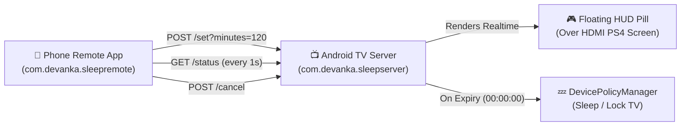

# 🎮 TV Sleep Timer & PS4 Rental HUD System

A complete dual-app IoT management system designed for **PlayStation Rental Businesses** and **Smart TV automation**. Control TV rental sessions, view live countdown timers, display an unobtrusive floating HUD overlay over HDMI games, and automatically put the TV into sleep/standby mode when time expires.

---

## 📥 Download File APK (Siap Install v2.0)

Silakan unduh file APK versi resmi terbaru (**v2.0.0**) di bawah ini:

| Aplikasi | Target Perangkat | Link Download APK v2.0 |
| :--- | :--- | :--- |
| 📺 **TV Companion Server** | Diinstal di **Android TV / Google TV** | [⬇️ **Download Devanka-TV-Sleep-Server.apk (v2.0.0)**](https://github.com/Qomar-dn/Sleep_Timer_GoogleTV-AndroidTV/releases/download/v2.0.0/Devanka-TV-Sleep-Server.apk) |
| 📱 **Phone Remote Control** | Diinstal di **Smartphone Android** | [⬇️ **Download Devanka-TV-Sleep-Remote.apk (v2.0.0)**](https://github.com/Qomar-dn/Sleep_Timer_GoogleTV-AndroidTV/releases/download/v2.0.0/Devanka-TV-Sleep-Remote.apk) |

> 📦 Seluruh versi rilis resmi juga dapat diakses langsung melalui [GitHub Releases](https://github.com/Qomar-dn/Sleep_Timer_GoogleTV-AndroidTV/releases).

---

## 🌟 Key Features (v2.0 Update)

### 📱 1. Phone Remote Control App (`phone-app` v2.0)
* **Dukungan Multi-TV (Hingga 5 TV)**:
  * Tombol tab/chip interaktif untuk berpindah kontrol antara **TV 1, TV 2, TV 3, TV 4, dan TV 5**.
  * Kustomisasi Nama TV (misal: "TV 1 - PS5", "TV 2 - PS4 Pro"), alamat IP, dan alamat MAC per slot TV.
* **Buku Panduan Penggunaan In-App**:
  * Tombol panduan di bagian atas yang membuka petunjuk langkah demi langkah lengkap.
* **Menu About (Tentang Pengembang & Aplikasi)**:
  * Informasi aplikasi, rincian fitur, dan identitas pengembang (**Qomar Dn - Devanka Playstations**).
* **Wake-on-LAN Otomatis**:
  * Bangunkan TV secara otomatis lewat jaringan Wi-Fi jika TV dalam keadaan mati/standby.
* **Live Circular Animated Countdown**: Real-time progress bar dengan sweep gradient neon ungu & cyan.
* **Flexible Preset Durations**: 15m, 30m, 45m, 1 Jam, 2 Jam, 3 Jam, serta stepper kustom +/- 15 menit.

### 📺 2. TV Companion Server (`tv-server` v2.0)
* **Zero-Dependency Embedded HTTP Server**: Runs a lightweight REST API on port `8765` with auto-reconnect retry loop.
* **Standby Wakeup & Auto-Start**: Otomatis aktif kembali saat TV dinyalakan dari mode sleep/standby.
* **Micro Floating HUD Overlay**:
  * Badge melayang di pojok kanan atas TV: `[ 🎮 SEWA 01:59:53 ]`.
  * **Floats over active HDMI sources (PS4/PS5 games)** using native Android TV `TYPE_APPLICATION_OVERLAY`.
  * Flagged `NOT_FOCUSABLE` & `NOT_TOUCHABLE`: 100% transparan, tidak mengganggu stik PlayStation.
  * **Warning State**: Otomatis berubah warna merah berkedip `[ ⚠️ HABIS 00:04:59 ]` saat waktu sisa di bawah 5 menit.
* **Auto Sleep / Screen Off**:
  * Menggunakan `DevicePolicyManager.lockNow()` untuk mematikan layar TV seketika saat timer habis.

---

## 🏗️ System Architecture



---

## 🔌 REST API Endpoints (Port 8765)

| Method | Endpoint | Description | Sample Response |
| :--- | :--- | :--- | :--- |
| `GET` | `/status` | Fetches current timer status | `{"active":true,"remaining_seconds":3595,"total_seconds":3600,"server":"Devanka TV","mac":"84:3E:1D:47:A2:2F"}` |
| `POST` | `/set?minutes=X` | Starts or resets timer for X minutes | `{"active":true,"remaining_seconds":7200,"total_seconds":7200,"server":"Devanka TV"}` |
| `POST` | `/cancel` | Cancels active timer & hides HUD | `{"active":false,"remaining_seconds":0,"total_seconds":0,"server":"Devanka TV"}` |

---

## 🚀 Quick Setup & Installation

### 1. Requirements
* Android TV / Google TV (Android 9.0+ / API 28+)
* Android Phone (Android 7.0+ / API 24+)
* Both devices connected to the same Wi-Fi network

### 2. Setting Up the TV
1. Install `Devanka-TV-Sleep-Server.apk` on the TV.
2. Grant required Device Admin and Overlay permissions via ADB:
   ```bash
   adb shell dpm set-active-admin com.devanka.sleepserver/.SleepDeviceAdmin
   adb shell appops set com.devanka.sleepserver SYSTEM_ALERT_WINDOW allow
   ```
3. Open **Sleep Timer Server** on your TV once to initialize the foreground service.

### 3. Setting Up the Phone
1. Install `Devanka-TV-Sleep-Remote.apk` on your Android smartphone.
2. Select slot TV (TV 1 s/d TV 5) and enter the TV IP address.
3. Tap **Hubungkan (Connect)**.
4. Select any preset or custom duration to start the rental session!

---

## 📄 License & Credits
Developed by **Qomar Dn** • **Devanka Playstations** (2026).  
Open-source under MIT License.
