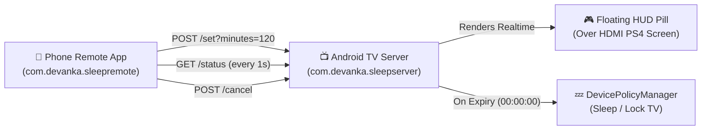

# 🎮 TV Sleep Timer & PS4 Rental HUD System

A complete dual-app IoT management system designed for **PlayStation Rental Businesses** and **Smart TV automation**. Control TV rental sessions, view live countdown timers, display an unobtrusive floating HUD overlay over HDMI games, and automatically put the TV into sleep/standby mode when time expires.

---

## 🌟 Key Features

### 📺 1. TV Companion Server (`tv-server`)
* **Zero-Dependency Embedded HTTP Server**: Runs a lightweight REST API on port `8765`.
* **Micro Floating HUD Overlay**:
  * Tucked into the far top-right corner of the TV screen.
  * Single-line ultra-slim design: `[ 🎮 SEWA 01:59:53 ]`.
  * **Floats over active HDMI sources (PS4 games)** using native Android TV `TYPE_APPLICATION_OVERLAY`.
  * Flagged `NOT_FOCUSABLE` & `NOT_TOUCHABLE`: 100% transparent to DualShock/DualSense controllers and TV remotes.
  * **Warning State**: Automatically transitions to glowing red `[ ⚠️ HABIS 00:04:59 ]` when under 5 minutes remain.
* **Auto Sleep / Screen Off**:
  * Employs `DevicePolicyManager.lockNow()` via Active Device Admin to immediately put the TV into sleep/standby mode upon timer expiration.
* **Auto Boot Start**: Runs as a sticky Foreground Service with auto-start on device boot.

### 📱 2. Phone Remote Control App (`phone-app`)
* **Cyberpunk & Gaming Dark Aesthetic**: Material 3 theme matching PlayStation styling.
* **Live Circular Animated Countdown**: Real-time progress bar with glowing cyan/purple sweep gradient.
* **Flexible Preset Durations**:
  * `15 Menit`, `30 Menit`, `45 Menit`
  * `1 Jam`, `2 Jam`, `3 Jam`
* **Custom Minutes Stepper / Input**:
  * Enter any custom duration (e.g., 75, 90, 150 minutes).
  * Quick `-15` and `+15` stepper buttons.
* **Instant Cancellation**: One-tap red button to immediately stop the timer and dismiss the TV overlay.

---

## 🏗️ System Architecture



---

## 🔌 REST API Endpoints (Port 8765)

| Method | Endpoint | Description | Sample Response |
| :--- | :--- | :--- | :--- |
| `GET` | `/status` | Fetches current timer status | `{"active":true,"remaining_seconds":3595,"total_seconds":3600,"server":"Devanka TV"}` |
| `POST` | `/set?minutes=X` | Starts or resets timer for X minutes | `{"active":true,"remaining_seconds":7200,"total_seconds":7200,"server":"Devanka TV"}` |
| `POST` | `/cancel` | Cancels active timer & hides HUD | `{"active":false,"remaining_seconds":0,"total_seconds":0,"server":"Devanka TV"}` |

---

## 🚀 Quick Setup & Installation

### 1. Requirements
* Android TV / Google TV (Android 9.0+ / API 28+)
* Android Phone (Android 7.0+ / API 24+)
* Both devices connected to the same Wi-Fi network

### 2. Setting Up the TV
1. Install `tv-server.apk` on the TV:
   ```bash
   adb install tv-server.apk
   ```
2. Grant required Device Admin and Overlay permissions via ADB:
   ```bash
   # Enable active admin for hardware screen locking
   adb shell dpm set-active-admin com.devanka.sleepserver/.SleepDeviceAdmin

   # Enable floating HUD overlay permission
   adb shell appops set com.devanka.sleepserver SYSTEM_ALERT_WINDOW allow
   ```
3. Open **Sleep Timer Server** on your TV once to initialize the foreground service.

### 3. Setting Up the Phone
1. Install `phone-app.apk` on your Android smartphone.
2. Enter your TV's local IP address (e.g. `192.168.1.78`).
3. Tap **Hubungkan (Connect)**.
4. Select any preset or custom duration to start the rental session!

---

## 🛠️ Building from Source

This project uses standard Gradle wrapper.

```bash
# Build TV Server APK
cd tv-server
./gradlew assembleDebug

# Build Phone Remote App APK
cd ../phone-app
./gradlew assembleDebug
```

---

## 📄 License
MIT License. Feel free to use and modify for your gaming center, rental business, or personal TV setup.
